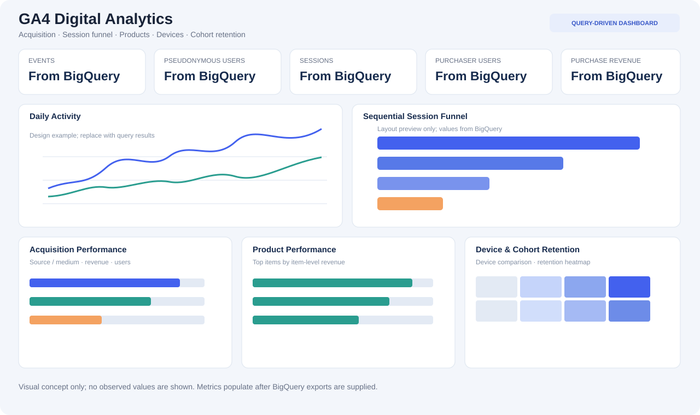

# GA4 Digital Analytics: Acquisition, Funnel & Retention

An event-level digital analytics portfolio project built on Google's public Google Analytics 4 (GA4) ecommerce sample in BigQuery. It explores acquisition sources, sequential purchase funnels, product performance, device behaviour, and observed user retention.

**Stack:** BigQuery GoogleSQL · GA4 event schema · Python/Pandas · Plotly · GitHub

**[Dataset documentation](https://developers.google.com/analytics/bigquery/web-ecommerce-demo-dataset)** · **[GA4 export schema](https://support.google.com/analytics/answer/7029846)** · **[Setup guide](docs/getting_started.md)**



## Why this project

Unlike order-level ecommerce and customer-campaign analyses, GA4 exports event-level clickstream data with nested parameters and repeated item records. A useful analysis must explicitly derive sessions, maintain correct data grain, define a sequential funnel, separate first-user acquisition from session attribution, and avoid duplicating revenue when unnesting items.

## Business questions

- How many users, sessions, and purchase events occur during the selected period?
- Where does a sequential product-view → add-to-cart → checkout → purchase funnel lose sessions?
- How do first-user source/medium groups differ in users, purchasers, and reported revenue?
- Which products generate the most units and item-level revenue?
- How do device categories differ in session and purchase behaviour?
- What monthly retention can be observed within the available sample window?
- Which missing IDs, transaction fields, or revenue values could distort reporting?

## Dataset

Google's public sample is available in BigQuery:

`bigquery-public-data.ga4_obfuscated_sample_ecommerce.events_*`

Google documents a sample period from 2020-11-01 through 2021-01-31 and warns that the dataset is obfuscated and may have limited internal consistency. Run `sql/01_dataset_profile.sql` to calculate exact metrics for the selected date filter; this repo does not claim that BigQuery queries have already been run.

## Project deliverables

- Eight BigQuery SQL scripts for profiling, quality, daily performance, sequential funnel, first-user acquisition, item performance, devices, and cohort retention.
- Documented data model and KPI definitions.
- Data-quality and interpretation caveats.
- Python dashboard builder with required-export validation.
- Responsive interactive Plotly dashboard generated from actual query-export CSVs.
- Static dashboard layout preview; illustrative design only, not measured results.

## Quick start

1. Open BigQuery in Google Cloud Console.
2. Run each SQL script under `sql/` separately.
3. Export results with the exact filenames in `docs/getting_started.md` to `outputs/bigquery_exports/`.
4. Install dependencies and build the dashboard:

```bash
python -m pip install -r python/requirements.txt
python python/build_dashboard.py
```

5. Open `dashboard/ga4_digital_analytics_dashboard.html` in a browser.

The dashboard builder refuses to generate a report when required export files are missing. It does not substitute invented results.

## Metric rules and limitations

- **User:** distinct non-null `user_pseudo_id`; this is a pseudonymous browser/app identifier, not a guaranteed real-person ID.
- **Session:** distinct pair of `user_pseudo_id` and `ga_session_id`, excluding missing components.
- **Purchase event:** a row with `event_name = 'purchase'`; event count and transaction count are not assumed to be the same.
- **Revenue:** GA4 reported revenue values are not profit and may be null or inconsistent in this obfuscated sample.
- **First-user acquisition:** top-level `traffic_source` fields represent first-user acquisition, not the source/medium of every later session.
- **Sequential funnel:** each session proceeds only when the next funnel event occurs at or after the prior-stage timestamp.
- **Retention:** first-observed-month retention within this short sample, not a complete lifecycle retention measure.
- **Causality:** no randomized holdout or dependable media-cost table is provided. Do not infer ROAS, CAC, incremental campaign lift, or causal effects.

## Skills demonstrated

BigQuery SQL · Nested/repeated GA4 schemas · Event/session modelling · Data-quality validation · Funnel analytics · Acquisition analysis · Product analytics · Cohort retention · Query-efficient date filtering · Python/Pandas · Interactive dashboarding · Business communication
